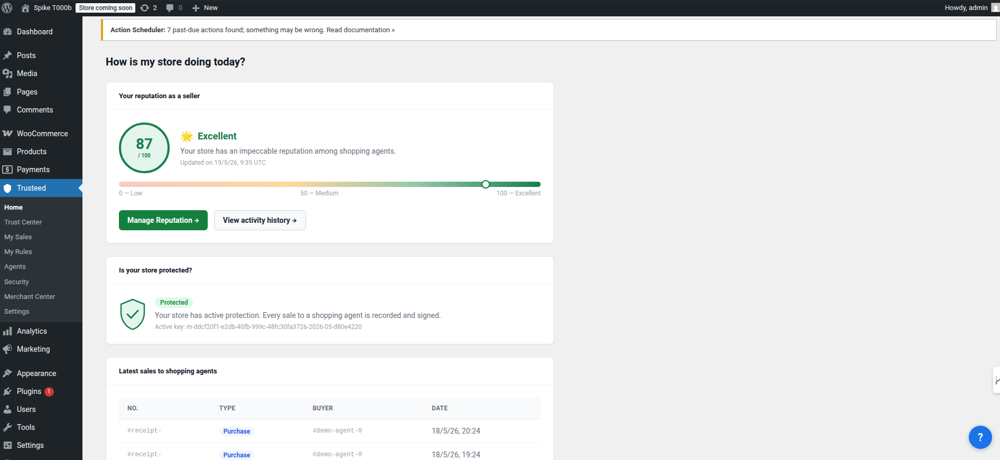
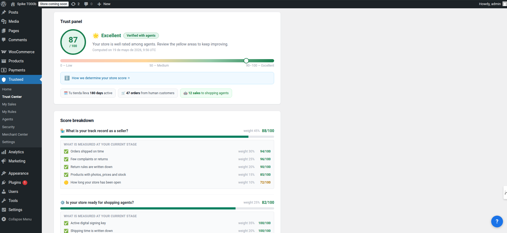
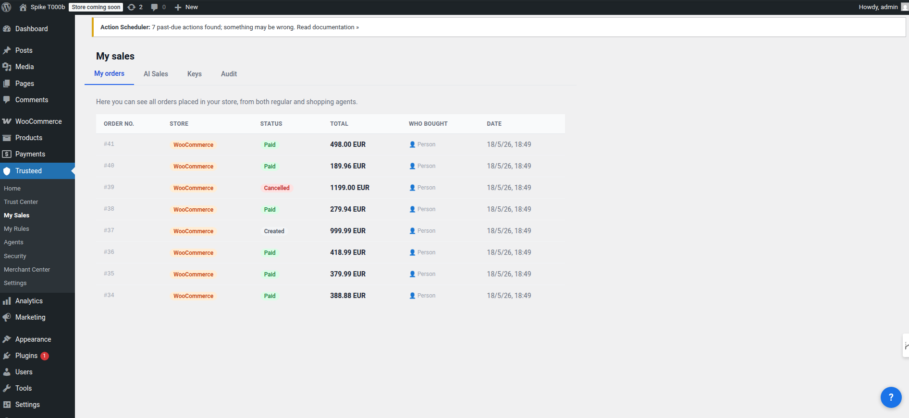
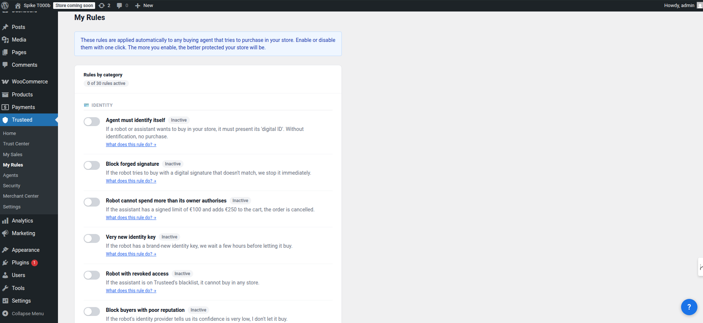
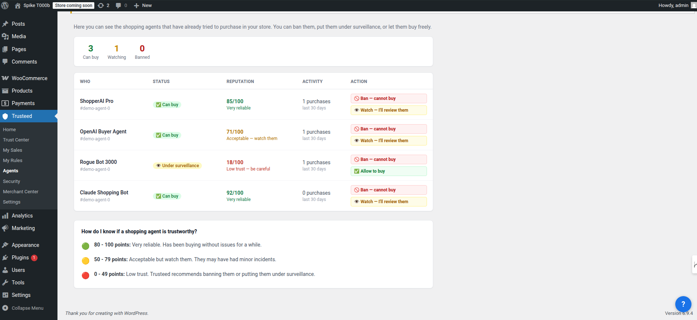
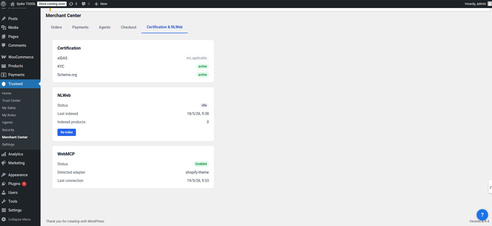
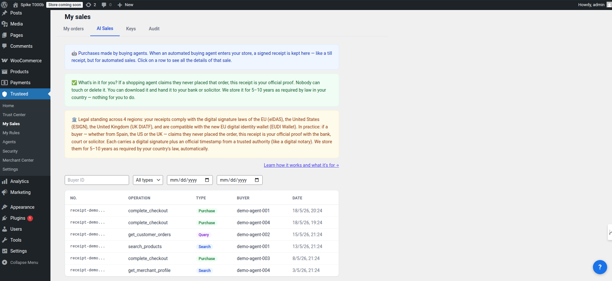
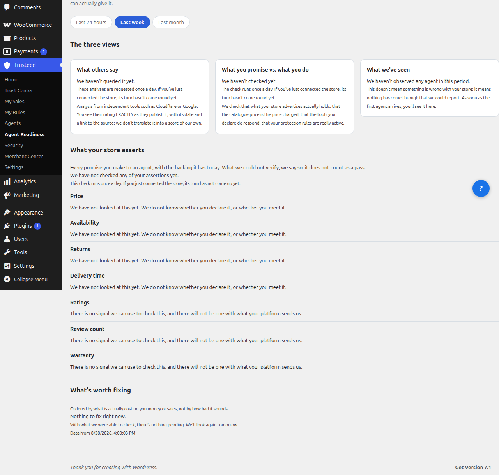

**English** | [Español](README.es.md) | [Français](README.fr.md) | [Deutsch](README.de.md)

# Trusteed Agentic Commerce for WooCommerce

AI agents are a new kind of online shopper. With Trusteed, the network that connects businesses and agents, they can buy from your store on your terms.

- Set your business rules: who can buy, up to what amount, which categories you don't offer to agents, price limits, stock levels that protect you from fraudulent agents, and more.
- Get signed receipts. Every transaction produces a cryptographically signed, tamper-evident receipt that records what the agent actually did, a verifiable proof of agent integrity. Aligned with eIDAS (EU) and with eSIGN (USA), but not yet a *qualified* signature or timestamp, so on its own it isn't ready-made dispute evidence for a bank or court.
- See what agents do: how much they spend, what they buy and how often.
- Block agents that look dangerous or cause problems.
- Accept purchases in digital currencies through the X402 protocol.
- Let agents and merchants trade directly, peer to peer.
- Check whether agents can buy from you. The agent readiness dashboard tests live whether AI agents can actually buy in your store today. It gives three independent views (what others say, what you promise versus what you do, what we've observed), and nothing is scored until it's verified.

## Screenshots

Each panel below maps to an item in the **Trusteed** menu inside WooCommerce.

| Home | Trust Center | My Sales |
|------|--------------|----------|
|  |  |  |

| My Rules | Agents | Merchant Center |
|----------|--------|-----------------|
|  |  |  |

| Trust Receipts (My Sales → AI Sales) | Agent Readiness |
|--------------------------------------|------------------|
|  |  |

Every agent transaction produces a signed trust receipt, a tamper-evident record (aligned with eIDAS and with eSIGN) listed under **My Sales → AI Sales**. Click a row to see the details: agent ID, tool called, input and output hashes, JWS. You can also download the receipt as a ZIP file. The export is a verifiable proof of agent integrity. It's a useful backup if a buyer claims they never placed the order, but on its own it doesn't replace the evidence a bank or court may require in a dispute.

## Features

The plugin connects your product catalog to AI shopping agents through the **Model Context Protocol (MCP)**, an open standard created by Anthropic. It never processes payments or touches sensitive customer data. Checkout always happens in your native WooCommerce checkout.

- MCP tools for agents: `search_products`, `browse_categories`, `get_product_details` and `create_cart`, which sends the shopper to the native WooCommerce checkout.
- Automatic catalog sync. Products sync through WooCommerce hooks when you create, update or delete them, stock changes included, and you can run a full manual sync from the settings page. Only public catalog data leaves your store (titles, descriptions, prices, images, categories, stock), never customer PII, orders or payment info.
- Agent token verification: `create_cart` passes the agent's JWS token on to checkout, so signature and replay verification (R002) runs in the normal flow.
- Enforcement gate (HITL): configurable human-in-the-loop approval for high-value agent orders.
- SSRF hardening: the API base that carries your credentials must be HTTPS on an exact host allowlist. Cloud IMDS addresses (`169.254.0.0/16`, `100.100.100.200`, `metadata.google.internal`), IPv6 unique-local (`fc00::/7`) and link-local (`fe80::/10`) are blocked in every environment. Loopback and RFC1918 addresses only work behind the explicit `TRUSTEED_ALLOW_LOCAL_API_BASE` dev opt-in, which is off by default.
- Fail-closed defaults: nothing is dispatched when the enforcement secret is empty, and reconnecting requires proof that you own the domain, which protects against cross-merchant takeover.

## Compatibility

| Component | Supported |
|-----------|-----------|
| WordPress | 6.0 – 7.0 |
| WooCommerce | 8.0 – 11.0 |
| PHP | 7.4+ (tested on 8.0–8.3) |

## Requirements

- WordPress 6.0+ with WooCommerce 8.0+
- PHP 7.4 or newer
- A Trusteed account ([sign up free at trusteed.xyz](https://trusteed.xyz))

## Installation

### Manual upload (recommended)

1. **Download the installable `.zip`** from the latest GitHub Release:
   [**⬇ Latest release: trusteed-agentic-commerce-woocommerce-&lt;version&gt;.zip**](https://github.com/Trusteedxyz/agentic-commerce-woocommerce/releases/latest)
   or browse all versions at the [Releases page](https://github.com/Trusteedxyz/agentic-commerce-woocommerce/releases).
2. In your WordPress admin: **Plugins → Add New → Upload Plugin**.
3. Select the downloaded `.zip` file and click **Install Now**.
4. Click **Activate**.

### From source (build the zip yourself)

```bash
git clone https://github.com/Trusteedxyz/agentic-commerce-woocommerce.git
cd agentic-commerce-woocommerce
bash build-zip.sh        # outputs dist/trusteed-agentic-commerce-woocommerce-<version>.zip
```

## Configuration

1. Log in to your WordPress **Admin**.
2. Go to **WooCommerce → Trusteed** (or the **Trusteed** menu item).
3. Enter your Trusteed email and password and click **Connect my store**. If you don't have an account yet, one is created for you. If you'd rather not use a password, click **Connect with API key** instead and paste your API key from [trusteed.xyz/dashboard/settings](https://trusteed.xyz/dashboard/settings).
4. The plugin registers your store and syncs your catalog. **Test connection** checks the link and **Sync catalog now** runs a full sync whenever you want one.

Once connected, any MCP-compatible agent (Claude, ChatGPT, or a custom one built with LangChain, CrewAI, Vercel AI SDK and similar tools) can search your products, browse categories, read product details and build carts. When the customer is ready to buy, the agent sends them to your native WooCommerce checkout, and your existing gateways (Stripe, PayPal, …) take the payment.

The full merchant walkthrough is in [`docs/MERCHANT_INSTALLATION_GUIDE.md`](docs/MERCHANT_INSTALLATION_GUIDE.md).

## FAQ

**What data is sent?** Only your public product catalog: titles, prices, descriptions, images, categories and stock status. No customer PII, payment data or order history. All communication uses HTTPS.

**Which agents are supported?** Any MCP-compatible agent: Claude (Anthropic), ChatGPT (OpenAI), and custom agents built with LangChain, CrewAI, Vercel AI SDK or any other framework that supports the Model Context Protocol.

**Does it slow down my store?** It adds one request at checkout. The plugin also talks to Trusteed when your catalog changes and when an agent acts on your store. When a customer places an order, whether an agent or a person, the plugin asks Trusteed to evaluate your rules. That request times out after 5 seconds. If Trusteed can't be reached, the plugin applies your rules from the last signed snapshot it pulled. If that isn't possible either, the result follows the `trusteed_failure_mode` option: `enforce` (the default) blocks the order and `observe` allows it.

## The agent readiness dashboard

**Can agents find me?** is a page in your admin panel that answers one
question: when an AI shopping agent visits your store, does it get what you
think it gets?

It never shows a single score. It shows three columns and doesn't average them,
because they answer different questions and can disagree:

| Column | What it is |
| --- | --- |
| **What a third party says** | The verdict of an external scanner, quoted verbatim. We never convert it to a scale of our own: rescaling someone else's grade would mean grading our own exam |
| **Does what you say match what you do?** | 16 checks that compare what your store *advertises* with what it *actually answers*. No external scanner can do this, because it needs your credentials |
| **What we have seen** | Real agent traffic in the selected window: which agents arrived, which tools they used, how far they got and where they failed |

A check that could not run is reported as **not checked**, with the reason. It
is never dropped silently and never counted as a pass. "We could not look" and
"we looked and it was fine" are different answers, and the page tells you which
one you're reading.

### What each check looks at

| Check | What it detects |
| --- | --- |
| C1 | You advertise tools your store does not serve |
| C2 | You advertise a checkout protocol whose endpoint does not answer |
| C3 | The catalogue price is not the price charged |
| C4 | Things are advertised as available when they are not |
| C5 | Your return policy says different things depending on where you look |
| C6 | You advertise as available something that is switched off |
| C7 | Rules switched on that cannot act for lack of data |
| C8 | Your rules observe but do not block |
| C9 | The identification method you advertise does not work |
| C10 | An agent can buy any amount without your confirmation |
| C11 | The point of sale is using expired rules |
| C12 | Operations with no signed receipt |
| C13 | Advertised addresses that do not work |
| C14 | Agents are seeing stale data from your store |
| C15 | Identity credentials about to expire |
| C16 | The delivery time you promise is not the one you meet |

Some checks need more than your settings to run, and the page says so instead of
leaving a gap:

- Needs your store connected (C3, C4, C5, C14): they compare against your real
  catalogue, and without credentials there is nothing to compare with.
- Needs delivered orders (C16): it compares what you promise with what you
  actually met, which can't be done without history.
- Nothing to compare this time: C12, for example, has nothing to check until an
  agent has completed a purchase. That is not a failing grade.

The checks run once a day and the page shows the result **with its date**, so a
verdict from yesterday looks like one from yesterday. A cached "all good"
passed off as current is exactly the kind of self-deception this page exists
to catch.

## Security Acknowledgements

We thank **MD Rabbi Hossain** ([LinkedIn](https://www.linkedin.com/in/csrrabbi/) · [X](https://x.com/csrrabbi)) for a responsible disclosure report against our identity provider, `auth.trusteed.xyz`.

The report's central claim is accurate: our OAuth dynamic client registration endpoint (`/oidc/register`, RFC 7591) accepts requests without a credential. That is deliberate: our MCP connectors, including Claude's, self-register through this endpoint before they can authorize at all, and requiring a credential there would break them. The access it enables is consent phishing, a property of any open dynamic-registration flow rather than unauthenticated access, and it does not reach checkout: our payment path requires a verified agent-identity claim that a token obtained this way does not carry.

Investigating the report surfaced something it did not flag: an OAuth scope (`mcp:admin`) was published across our discovery documents and offered on the consent screen, but no code enforced it: a token holding it carried the exact same privileges as `mcp:read`. That scope has been retired platform-wide. The fix lives in our private API and dashboard, not in this plugin, but we record the credit here as agreed with the reporter.

## Changelog

### 2.5.3
- New: the plugin now answers `/llms.txt` on your site (only when that address does not exist yet) and adds a link to it in the page header. It points AI agents to your store's MCP endpoint and tells them that buying through the website's own buttons carries no verifiable agent identity. It is plain public text, it changes no checkout behaviour, and it does nothing until the store is connected to Trusteed.
- New: when an agent order is created and still waits for payment, the agent orders endpoint now also returns `payment_url`, the WooCommerce pay-for-order link, so a person can pay it with your own payment methods. It is only returned while the order is Pending payment, and it is never used to take payment on the agent's behalf.

### 2.5.2
- New: browser agents (browser-use style) that sign their requests with RFC 9421 HTTP Message Signatures are now recognised at checkout, according to the `browser_agent_signature_mode` setting. This release also contains the change below, so it bundles two independent changes.
- Change: when the store's rules block an order that an agent placed through Trusteed, the plugin now tells Trusteed why (`reason_category`, `rule_code`, `reason`, `next_action` on the `422 rule_blocked` answer), so the agent knows what to do next instead of getting a bare refusal. With a Trusteed server that sends `agent_reason` the reason is the server's verdict. With an older server the plugin derives a generic reason itself (`merchant_policy` or `checks_unavailable`) and marks it with `reason_source: plugin_fallback` so it is never taken for the server's verdict; it does not stay silent. `rule_code` is kept only if it looks like a rule code (up to 64 characters); anything else is dropped. An error that is not a rule block no longer answers as `rule_blocked` (it uses `order_invalid`).
- Change: the same answer can also say what caused the block when Trusteed knows it: `blocked_item` (a category, a SKU or a digital product type), `published_limit` (the limit the store published, only when the rule that fired has one) and `human_checkout` (a link to your own human checkout, only if you provided one). Each key is checked on its own and dropped if it does not look right.

### 2.5.1
- Fix: when a store requires a verified agent identity, orders that Trusteed creates for a verified agent are no longer blocked by the plugin's own second check. The plugin now passes along the identity level Trusteed resolved (only the four known values are accepted; anything else is ignored). Update the plugin before turning that rule option on.

### 2.5.0

- Change: an agent order is no longer marked as paid unless the payment provider confirms the charge. The plugin now checks the payment (Stripe PaymentIntent or PayPal capture) with the credentials of your own account; if it cannot confirm it, the order stays On hold and the agent orders endpoint answers `409 payment_not_verified` (definitive) or `503 payment_verification_unavailable` (provider unreachable or no credentials; Trusteed retries). Review On hold orders from agents in WooCommerce > Orders. If the charge was made on a Trusteed demo account instead of your own, it will not be confirmed by design.

### 2.4.9

- Fix: variable products now send their variations (price, stock and attributes) with the catalog sync. Before, Trusteed listed a variable product without any variation, so an agent could add it to the cart without choosing one and the store refused to price the order. Variations without a price are skipped. Run "Sync catalog" once after updating so existing products pick them up.

### 2.4.8

- New: the hourly heartbeat now also sends the link, title and last-modified date of your Terms and Privacy Policy pages (only if they are published). Trusteed shows them to agents as imported from your store, separate from the policies you declare. The page content is never sent.

### 2.4.7

- New: orders paid through PayPal can now be marked as paid on your store. The agent orders endpoint accepts a PayPal capture reference (with `payment_method = paypal`) next to the Stripe PaymentIntent, and titles the payment method as PayPal. Stripe payments are unchanged.

### 2.4.6

- New: "Use my WooCommerce PayPal account" in the Payment methods panel. The credentials already set in WooCommerce PayPal Payments are sent to Trusteed by your site (never through the browser) and kept in sync when you change them; disconnecting PayPal there disconnects it in Trusteed too. Payments go to your own PayPal account. Opt-in.

### 2.4.5

- New: "Use my WooCommerce Stripe account" in the Payment methods panel. The Stripe key already set in the WooCommerce Stripe plugin is sent to Trusteed by your site (never through the browser) and kept in sync when you change it. Opt-in.
- New: purchases paused for your approval show up under My sales, and a notice on Home tells you when one is waiting.

### 2.4.4

- Fixed: the capabilities report no longer includes cart signals that no rule reads. The Trusteed API rejected the whole report (HTTP 400), so the rules checks in the dashboard stayed without a verdict.
- Fixed: a rejected capabilities report is retried after one hour instead of on every page load.
- Changed (My sales): an order placed by an AI agent now shows the agent and the client it declared (for example ChatGPT or Claude), the channel and payment method (for example "Agent · MCP · x402"), and the real total. It used to show "Other channel", "Person" and "0.00 USD". The order number opens the signed Trust Receipt of the purchase. Requires the matching Trusteed API update.
- Changed (Security log): an entry without an agent id is no longer labelled "Person"; tool calls are labelled as agent activity.
- Changed (Agent readiness): a check without a verdict now says why (needs a setting, waiting for data, does not apply, we will retry) instead of "Not checked"; checks that do not apply are counted apart. The three panels are stacked full width and wide tables no longer overflow their card.

### 2.4.3

- New: the hourly heartbeat also reports your tax display settings (prices entered with or without tax, and how the shop shows them), so Trusteed can tell whether the catalog price and the price an agent sees are comparable. No customer data.

### 2.4.2

- New: the plugin reports which cart signals it provides to Trusteed (`POST /api/v1/enforcement/capabilities`, signed with the installation secret) on update, after saving credentials and once a day, so the dashboard can tell which rules your store can actually feed. Network failures are logged and never break the admin.
- New: an hourly heartbeat (WP-Cron) tells Trusteed the plugin is alive, so a quiet store is no longer reported as out of date.
- New: when an order is marked Completed, the plugin sends an `order.completed` event (no customer data: id, number, totals, dates and the agent id when present) so Trusteed can compare your shipping promise with real fulfilment times. Requires a connection made with 2.4.1 or later.

### 2.4.1

- Fixed: connecting a store never saved its enforcement credentials (installation id, installation secret and WooCommerce webhook secret). Trusteed sent them, but the plugin dropped them before saving, so everything signed with the installation secret was refused: rule snapshots, agent events and the `trusteed/v1/*` endpoints. Stores connected before this fix must reconnect once.
- Fixed: reconnecting a store that was already registered did nothing. Trusteed asks for proof that you control the domain; the plugin now answers it automatically by serving a one-time token at `/.well-known/amcp-verify.txt` for up to ten minutes (no file is written).
- Fixed: the catalog sync was rejected by the Trusteed API (HTTP 400) for any store with product categories, because category ids were sent as numbers instead of strings. Products that do not manage stock also no longer send a null stock quantity, which the API rejects.
- Fixed (documentation): the connection steps in the readme and the merchant guide described pasting an API key from the dashboard. The plugin connects with your Trusteed email and password ("Connect my store"); an API key is only for reconnecting an existing store. The guide also states the real requirements (HTTPS, non-Plain permalinks, password rules) and no longer promises an automatic initial catalog sync or a working "Sync" button.
- Known issue: the "Sync" button on the settings page only refreshes the store registration; it does not push the full catalog.

### 2.4.0
**Trusteed can now create and confirm orders in your store on behalf of an AI agent (off by default).**

- New: a payment method called "Trusteed (agente)" (`trusteed_agent`). It never appears at checkout; it only labels orders that Trusteed creates and charges outside WooCommerce.
- New: three REST endpoints under `/wp-json/trusteed/v1/`: `POST /quote` (price, shipping, taxes and discounts calculated by WooCommerce itself), `POST /orders` (creates the order once per Trusteed order id, checks that the total matches the approved one, and runs your store rules) and `POST /orders/{id}/paid` (confirms the payment and reduces stock).
- Off by default: nothing is registered unless the option `trusteed_agent_orders_enabled` is set to `yes`.
- Security: every call must carry `X-Trusteed-Signature: t=<unix>,v1=<hmac>` signed with the installation secret, inside a +/-300 second window; a signature is accepted once only. A bad signature gets a plain 401 with no detail.
- A paid amount that does not match the order puts it on hold with a note for you to review; a total that does not match the approved one deletes the order before anything is charged.

### 2.3.6
**A shopper is no longer blocked at checkout when Trusteed cannot answer.**

- Fixed: a valid agent token minted by Trusteed's own contract was rejected as invalid (`_agent_token_jti_missing`). The plugin required a `jti` claim that the canonical token (the schema, the server verifier and the repository's token generator) does not carry: its single-use identifier is `nonce`. The plugin now reads `nonce` (16–64 characters, letters, digits, `_` and `-`) as the single-use identifier it sends to the call that stops a token from being used twice; `jti` is only accepted as a legacy alias when `nonce` is absent, and `nonce` wins if both are present and differ. A token with neither, or with a malformed one, is still an invalid token (the `_agent_token_jti_missing` / `_agent_token_jti_malformed` markers are kept and now cover the nonce) and nothing is spent on the server. Strictly tighter than before in one respect: a `jti` between 65 and 128 characters, or a `nonce` outside that alphabet, no longer passes.
- Fixed: if the Trusteed API was unreachable, slow, rate-limited or returned an error, the "enforce" failure mode blocked every checkout, people included. Now the failure mode only applies to checkouts started by an AI agent. A person's checkout goes through; the only thing that can still stop it during an outage is one of your own store-wide limits (for example your maximum order amount), checked against the last rules the plugin downloaded.
- Fixed: an unexpected error of the plugin's own while checking an order (token verification, the offline safety valve or the rules client) no longer aborts a person's checkout. An agent's checkout is held in every failure mode, worded as an outage and not as a rule; a person's goes through. The error class is logged, never its message.
- Fixed: a store whose merchant ID is not configured (the plugin is not connected to Trusteed) no longer blocks anyone at checkout: there are no rules to check against, so neither people nor agents are held.
- Fixed: during an outage, agent-only rules are no longer applied to people's checkouts.
- New: carts created by Trusteed's MCP carry an origin marker in the checkout link (`trusteed_origin`), so an agent without an identity is treated as an agent, not as a person. Removing the marker from the link only makes the checkout look like any other visitor's; adding it only makes the checks stricter.
- Fixed: the "enforcement indeterminate" signal sent to Trusteed when an agent checkout could not be evaluated was never sent. It is now.
- Security fix: an order was credited to whatever agent ID came in the checkout link, with nothing proving it, anyone could pin their orders, refunds and cancellations on another agent's history. Now an order is credited to an agent only when that agent's signed token checks out for that same ID. A link that names one agent and carries another agent's token is treated as carrying an invalid token. Through the WooCommerce REST API, the agent-credit fields of an order can no longer be written; the order keeps what it had.
- Fixed: an agent that only sent its signed token (in the checkout link, the checkout form or the block checkout request, in the `_trusteed_agent_token` field) was treated as a person. It is now treated as an agent, and a token that is not even well-formed counts as an invalid agent token, never as "no token".
- Changed: when an agent's checkout is stopped because Trusteed could not be reached, the message now says the order could not be verified right now (block checkout answers 503) instead of claiming it failed your rules.
- Security fix: an agent ID that was only stated (in the checkout link) and not proven by a valid signed token was still sent to Trusteed as the agent's identity. Trusteed keeps each agent's history (orders, refunds, disputes, failed checkouts) under that ID, so an agent could borrow another agent's record, and anyone could use up another agent's counters with a made-up token. Now only an ID proven by a valid token is sent. Any other agent checkout is checked as an agent without an identity: your agent rules still apply, and if you have the rule that requires a verified agent identity (R001) turned on, it blocks the checkout. A token that cannot be checked (for example, signed by a key Trusteed does not know) now counts as an invalid token.
- Changed: when the service that stops a signed token from being used twice cannot be reached, the agent is no longer treated as anonymous: its signature did check out, so its identity is kept and the checkout carries a `_agent_token_nonce_unavailable` marker (Trusteed ignores the plugin's allowlist for it). In "enforce" failure mode the agent is held before Trusteed is asked, worded as "could not be verified right now", not as a rule, even if your rules would have let it through; in "observe" it goes through. In both cases the order is not credited to that agent's history, because without the single-use check the token cannot be told from a replay. A token whose signature could not be checked at all (its ID is not among Trusteed's agent keys) is still an invalid token, as before.
- Fixed: a checkout link whose agent parameters were written as a list (for example `?trusteed_agent_token[]=x`) made the checkout page fail with a server error. The page now loads and the checkout is treated as an agent's with an invalid token.
- Security fix: the rule snapshot is only used once its signature checks out. Before, if Trusteed's signing keys could not be downloaded (or the PHP `sodium` extension was missing) the plugin read the snapshot without checking it and used its agent keys and its rules as if they were genuine.
- Changed: an agent checkout that carries a signed token is held (the agent is told the order could not be verified right now) in both failure modes, "observe" included, when there is no rule snapshot that checks out, Trusteed cannot be reached and there is no recent copy, or the snapshot Trusteed sent does not check out even after downloading its signing keys again. Without the snapshot the token cannot be checked, so letting it through would let a forged token pass. Trusteed is not asked in that case and the token is not used up. A person's checkout is never held by this.
- Changed: when Trusteed does not answer and the rule snapshot does not check out, your store-wide limits in that snapshot are not applied (they may not be yours) and an agent checkout is held in both failure modes; a person's checkout goes through. With a snapshot that checks out, nothing changes: your limits still apply to everyone and the failure mode decides for agents.
- Changed: the agent keys in the rule snapshot are read in both the current list format and the older per-agent format; a malformed entry for an agent no longer hides a good key listed before it.
- Fixed: large rule snapshots are now read. When your rules pass about 50 KB (for example, with many registered agents) Trusteed sends them compressed, and the plugin could not read them: with the change above, every agent checkout with a signed token would have been held. They are now decompressed only after their signature checks out, and never beyond 2 MB; one that still cannot be read counts as "Trusteed cannot be reached", not as a snapshot that does not check out.
- Changed: with the Trusteed AgenticTools plugin (2.0.3 or later) also active, this plugin is the one that evaluates the classic and the block checkout, with or without an agent token; AgenticTools stands aside on those two paths (it still evaluates orders created through the WooCommerce REST API, which this plugin does not evaluate). Before, an agent token was evaluated by both plugins, twice per checkout, and the two token formats could disagree.
- Fixed: an unexpected error while reading the cart or the order to build the checkout evaluation (before the check itself ran) could still abort a person's checkout. It is now handled like any other internal error of the plugin: a person's checkout goes through, an agent's is held as an outage and not as a rule, and only the error class is logged.
- Security fix: a rule snapshot whose signature does not check out is no longer retried against Trusteed's signing keys on every checkout: after one failed re-download the result is remembered for 60 seconds (WordPress transient), per server and per signing key (`kid`) of the snapshot, so a legitimate key rotation is not mistaken for tampering just because another attempt failed a moment earlier. If the transient cannot be written, the plugin retries as before.
- Security fix: the signed `validUntil` of the rule snapshot is now checked. A snapshot that is already expired (for example an old, validly signed one replayed by an attacker on the network) counts as "no snapshot that checks out"; a cached copy that outlived its own `validUntil` is not used. A snapshot without `validUntil`, or with one the plugin cannot read, is treated the same way (see the next entry).
- Security fix: a snapshot response larger than 4 MiB is refused before it is verified, and a signed token or snapshot whose header carries a `crit` field (RFC 7515) is rejected, because the plugin understands no critical extensions.
- Security fix: a rule snapshot signed by Trusteed always carries its expiry date (`validUntil`, ISO-8601 with time zone). One that arrives without it, or with one the plugin cannot read (a number, a relative date such as "tomorrow", an impossible date), now counts as "no snapshot that checks out", exactly like an expired one: it is never reported as tampered, because its signature did verify, and neither a freshly served copy nor a cached one is used. Before, a missing date meant the copy never expired. The agent-token check already rejected a `crit` header (RFC 7515).

### 2.3.5

**Error messages from Trusteed now reach you as sentences, not codes.**

- Fixed: when Trusteed rejected a request, the plugin showed you its machine code instead of the explanation that came with it. You saw "API error 409: wrong_deployment" where the server had actually sent a sentence telling you what happened and what to do about it. The sentence now wins; the code is still available to the plugin.

### 2.3.4

- New: a check that could not run now says why in one of four groups (nothing to do, needs configuration, waiting for data, or one of our own checks failed) instead of one flat list of unexplained grays.
- New: the panel now shows which of our servers answered your request, a short opaque label. Useful when comparing what you see here with what support sees; it never reveals a hostname or service name.

### 2.3.3

- New: Settings now lets you choose which tools your store serves to agents. If you never saved a list, the panel tells you that what you serve is the basic set the platform ships with, not a choice of yours.
- New: a button to re-run the readiness check without waiting for the daily sweep, and the panel remembers what changed since the previous run.
- Changed: our own outages no longer count as your store's mismatches. The panel keeps them separate, because there is nothing you can do about them.

### 2.3.2

- Fixed: the agent readiness page shipped without its stylesheet, so the panel rendered unstyled.
- Fixed: the panel could show its shell in one language and the diagnosis in another. The resolved language now travels with the texts instead of being detected twice.
- New: every finding carries a link to where it is fixed, and the merchant's own claims, the delivery promise and the rest, appear with the backing each one has.
- Changed: a store with no run yet reads as "checking" instead of "checked once a day": opening the panel already triggers the first run in the background.

### 2.3.1

- Critical fix: 2.3.0 shipped a PHP parse error in the admin router (`->render_spa_shell()` with no `$this`, and `array( , 'render_agent_readiness' )`). Activating it fataled the **entire WordPress admin**, not just the Trusteed pages. Anyone on 2.3.0 should upgrade immediately. Every PHP file in the plugin is now syntax-checked.
- Fixed: the Agent Readiness page rendered the Trust Center instead. The SPA mount validates the section against an allowlist and `agent-readiness` had never been added to it, so it fell back silently: the merchant clicked "Agent Readiness" and got a different panel.

### 2.3.0

- New, agent readiness dashboard: *Can agents find me?* now ships in the admin panel. It contrasts what your store advertises with what it actually answers, in **16 checks**, and shows all sixteen, not only the ones that fail. A check that could not run says **why** (store not connected, no delivered orders yet, nothing to compare this time) instead of leaving a gap that reads like a fault. See "The agent readiness dashboard" above.
- Fixed: the diagnosis was written in Spanish inside the API and shown verbatim, so a merchant with the panel in English read English headings above Spanish findings. The checks now emit language-neutral codes and the text is composed when served, in the language you are using.
- Fixed: check C1 ("you advertise tools your store does not serve") counted the full public catalogue as served when no tool list was configured, reporting 46 of 48 answering when the server actually serves 12. It failed in the flattering direction, which is the one this panel exists to catch.
- Fixed: check C6 ("you advertise as available something that is switched off") reported a capability as off whenever its flag was unset, even for flags that are on by default. It was a false alarm on every store.

### 2.2.2

- Security fix: the API client accepted a loopback or RFC1918 API base URL (`10.*`, `172.16–31.*`, `192.168.*`, `localhost`, `127.*`) in **every** environment, with plain HTTP tolerated. An install whose API URL had been redirected would send its `X-AgenticMCP-Key` credential to an internal address. The dev override is now opt-in and off by default, enabled only via `TRUSTEED_ALLOW_LOCAL_API_BASE` or a `local` WordPress environment type. It is the same gate `Trusteed_Token_Broker` already applied via `WP_DEBUG`, which this client had dropped.
- Security fix: cloud instance metadata and IPv6 internal ranges are now denied outright in every environment, *including* under the dev override, which previously re-opened all of them: `169.254.0.0/16` (IMDS), Alibaba `100.100.100.200`, `metadata.google.internal`, unique-local `fc00::/7`, link-local `fe80::/10`. They also get their own error code instead of the misleading "configure an HTTPS URL" message.
- Fixed: IPv6 API hosts never matched any check: `parse_url()` returns them bracketed (`[::1]`), so the `::1` loopback entry was dead code.
- Privacy fix: uninstalling left 21 option rows behind, including three encrypted secrets (`trusteed_embed_wp_secret`, `trusteed_enforcement_hmac_secret`, `trusteed_woo_webhook_secret`) and the legacy `amcp_*` aliases the option accessor still reads as a fallback, so a reinstall could resurrect a stale secret. `uninstall.php` now clears all three namespaces plus the cached snapshot and JWKS transients. A new test scans the source for every writable option key and fails if the uninstall list falls behind.
- Docs fix: trust receipts were described as "proof of the actual transaction in case of any dispute". The product itself says the opposite: a verifiable integrity proof, not ready-made dispute evidence for a bank or court. Corrected here to match.
- Docs fix: the deactivation FAQ claimed deactivating disconnects the store and that no residual data remains on our servers. Deactivation is inert, and disconnecting retains the store record and synced products. Corrected, with the deletion-request route documented.
- Docs fix: the catalog was described as syncing "variants and reviews"; neither is sent. The transmitted field list is now exact.
- Docs fix: `Tested up to` / `WC tested up to` disagreed between `readme.txt` (6.9 / 10.6) and the plugin header (6.7 / 9.5). Both now read 6.9 / 10.6. Automated tests run against WordPress 6.8 with latest-stable WooCommerce on PHP 8.1–8.2.
- Docs fix: repaired 404 links: `/developers`, `/privacy` and `/terms` need the `/en/` prefix, and `/support` does not exist (replaced with the contact form and GitHub issues).

### 2.2.1

- Fixed: `browse_categories` fed the same wrapped string to both the machine-readable and narrated channels. `guardMerchantField` wraps merchant text in `<<<MERCHANT_CONTENT_START>>> … <<<MERCHANT_CONTENT_END>>>` by default so an agent can tell "this is merchant data, not an instruction", but the tool reused that already-wrapped string for `structuredContent` too, so a category named "Sneakers" surfaced as `<<<MERCHANT_CONTENT_START>>>Sneakers<<<MERCHANT_CONTENT_END>>>` in the machine channel. `structuredContent` now gets the unwrapped value; the delimiters stay only where they do their job, in the narration.
- Fixed: rule R047 (minimum contribution amount) had no form field in the admin panel; its parameters existed in the schema but could only be set via the API.
- Fixed: `MerchantCheckoutConfig` had translated copy for an empty state (`noRails`, present in both `en.ts` and `es.ts`) that the component never rendered, so a merchant with no configured payment rails saw an unexplained empty list.
- Fixed: the admin panel bundle (`assets/admin-spa/`) shipped unminified: 869 KB / 25,064 lines instead of the 490 KB / 41 lines the documented build command actually produces. Rebuilt from source with a stable output filename (`admin-spa.js`), matching the other three platform connectors.

### 2.2.0

- Security fix: the agent token verifier treated `exp` and `iat` as optional: both guards hung off `> 0`, so a token that simply omitted the claim skipped the check entirely. Without `exp` it never expired; without `iat` it had no maximum age. Both claims are now mandatory, and a non-numeric value is rejected rather than cast. Replay protection was already fail-closed here (a missing or malformed `jti` is rejected), so this closes the remaining half.
- Security fix: an `iat` in the future is now rejected (30s of clock skew tolerated). Combined with the max-age window it gave a sliding lifetime: `now - iat` stays small for as long as the issuer pushes the claim forward, so the token effectively never grew old.
- Fix: rule R036 (max line-item value) read its cap from a parameter named `maxCents`, copied from R035. The canonical name is `maxCentsPerLine`, and it is the only one the merchant panel's strict schema accepts, so a merchant-configured cap would never have reached the check. The canonical key is now read first; `maxCents` stays accepted as a fallback.
- Fix: the cross-language conformance test resolved its fixture through a path that only exists in the development monorepo, so it failed in this repository. It now reads the copy shipped in `tests/fixtures/`.
- Trust receipts: the admin SPA bundle is rebuilt with the receipt download button, which exports a receipt as a ZIP through the same endpoint the hosted dashboard uses. The button states plainly what the export is: proof of agent integrity, not dispute evidence.

### 2.1.0

- Rebrand: internal classes, option keys and REST routes are renamed from `Amcp_`/`amcp_` to `Trusteed_`/`trusteed_`. Existing installs keep working. Legacy `amcp_{key}` options are still read as a fallback, legacy REST namespaces stay registered next to the new ones, and the legacy encrypted-value prefix still decrypts.
- Fix: the R043 HITL payload now passes through end to end, so a BLOCK can surface a human-in-the-loop freeze instead of a hard block that loses the buyer's intent.
- Fix (critical): the compiled admin SPA bundle (`assets/admin-spa/`) was missing from the distributed package. The Trusteed admin panel showed a "bundle not compiled" error on every install. The bundle now ships correctly.
- Hardening in billing webhooks, the checkout enforcer, catalog sync and cart signals.

### 2.0.2

Checkout enforcement fix. Merchant rules (max order amount, blocked countries, business hours) were skipped entirely for organic, non-agent checkouts. They now apply to every checkout. Added an offline safety-valve evaluator that enforces these rules locally when the remote rules API is unreachable.

### 2.0.1

Critical activation and security hotfix (Codex audit). Fixes a half-finished `AGENTICMCP_*` → `TRUSTEED_*` rename that prevented activation in 2.0.0. `create_cart` now forwards the agent JWS token so R002 verification runs. The REST client validates the API base host against an exact allowlist.

### 2.0.0

Security and reliability sprint. Disconnecting is now a two-phase flow with a confirmation token. Reconnecting requires proof of domain ownership (`/.well-known/amcp-verify.txt`). `create_cart` gets a real cart-bridge endpoint. The agent-event webhook retries with exponential backoff. Also SSRF hardening and fail-closed enforcement defaults.

## Support

- Support email: support@trusteed.xyz
- GitHub issues: [github.com/Trusteedxyz/agentic-commerce-woocommerce/issues](https://github.com/Trusteedxyz/agentic-commerce-woocommerce/issues)

## License

GPL-2.0-or-later. See [LICENSE](LICENSE) for full text.
